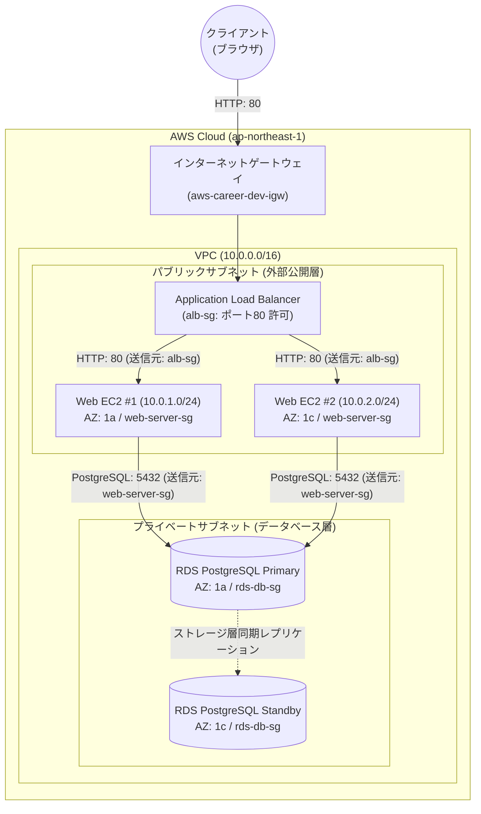

# 基本原理から学ぶAWSとTerraform：高可用性3層インフラ

本リポジトリは、Zenn Book『基本原理から学ぶAWSとTerraform：仕組みを理解して組み上げる高可用性3層インフラ』の公式ハンズオン用Terraformリポジトリです。

AWS上で堅牢なWebシステムを構築するための標準的な3層構成（VPC・ALB・EC2・Multi-AZ RDS）を、実務水準のモジュール分割とリモートステート管理によってIaC（Infrastructure as Code）として実装しています。

---

## 1. アーキテクチャ概要



- **ネットワーク層 (`modules/vpc`)**: 
  2つのアベイラビリティゾーン（AZ-A, AZ-C）にまたがるパブリック/プライベートサブネット（計4サブネット）、インターネットゲートウェイ（IGW）、明示的ルートテーブルを定義。
- **負荷分散・Web層 (`modules/compute_alb`)**: 
  多段セキュリティグループ（ALB用SG -> Web用SG）による通信隔離、HTTPヘルスチェック付きApplication Load Balancer（ALB）、Multi-AZ分散配置されたEC2 Webサーバー。
- **データ層 (`modules/database_rds`)**: 
  DBサブネットグループ、Web層SGからの通信のみを許可するDB用SG、AWS Secrets Managerによるパスワード動的秘匿化、Amazon RDS Multi-AZ（ストレージ層同期ブロックレプリケーション + DNS自動フェイルオーバー）。
- **ステート管理 (`environments/dev/backend.tf`)**: 
  S3バケット（暗号化・バージョニング）と `use_lockfile = true`（S3ネイティブ排他ロック）によるチーム開発前提のリモートバックエンド（Terraform 1.10+）。

---

## 2. ディレクトリ構成

```
.
├── README.md                      # 本ドキュメント
├── docs/
│   └── adr-001-architecture.md    # 設計決定理由書 (ADR)
├── environments/
│   └── dev/
│       ├── backend.tf             # S3 + DynamoDB リモートステート設定
│       ├── main.tf                # 親モジュール配線
│       ├── variables.tf           # dev環境の入力変数
│       ├── outputs.tf             # 最終出力定義 (ALB DNS名等)
│       └── terraform.tfvars.example # パラメータサンプル
└── modules/
    ├── vpc/                       # ネットワーク基盤
    │   ├── main.tf
    │   ├── variables.tf
    │   └── outputs.tf
    ├── compute_alb/               # 負荷分散 & Webサーバー
    │   ├── main.tf
    │   ├── variables.tf
    │   └── outputs.tf
    └── database_rds/              # データベース層
        ├── main.tf
        ├── variables.tf
        └── outputs.tf
```

---

## 3. 前提条件

- Terraform >= 1.10.0
- AWS CLI がインストールされ、適切なIAM権限（管理者相当）が設定されていること
- リージョン: `ap-northeast-1` (東京)

---

## 4. デプロイ手順

### ステップ1: 設定値の準備
```bash
cd environments/dev
cp terraform.tfvars.example terraform.tfvars
# 必要に応じて terraform.tfvars を編集
```

### ステップ2: バックエンドの初期化
```bash
terraform init
```

### ステップ3: 実行計画の確認 (ドライラン)
```bash
terraform plan
```

### ステップ4: インフラのプロビジョニング
```bash
terraform apply
```
プロビジョニング完了後、Outputsに出力された `alb_dns_name` に対し、ブラウザまたは `curl` でアクセスして疎通を確認します。

---

## 5. リソースの撤収 (課金停止)

学習完了後、不要な維持費を防止するために全リソースを一括破棄します。

```bash
terraform destroy
```
